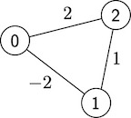

# CMPS 6610 Problem Set 05
## Answers


**Name:** Aayush Oza


## 1. Shortest shortest paths


**1b) (4 pts)** Work and span 

I run Dijkstra but with the key being the pair $(\text{weight}, \text{hops})$ instead of just the weight, compared lexicographically. Two paths of equal weight get broken by the smaller edge count, which is exactly what the question asks for. Since tuple comparison is $O(1)$, nothing about the cost changes.

Each edge is relaxed once and each relaxation can push onto the heap, so there are at most $|E|$ heap operations at $O(\log |E|)$ each.

$$W(n) = O(|E|\log|E|)$$

Dijkstra is inherently sequential, since the next vertex to settle is not known until the current `delete-min` returns, so the span matches the work: $S(n) = O(|E|\log|E|)$.


## 2. Expression Trees


**2a) (3 pts)** Expression tree algorithm with work and span

Scan the expression and use a `scan` with `plus` over $+1$ for `(` and $-1$ for `)` to get the nesting depth at every position. The operator that splits the expression is the one sitting at minimum depth outside any inner parentheses. Find it with a `reduce` over the depth array, split the string there, and recurse on the left and right pieces in parallel.

Each level does $O(n)$ work for the scan and reduce, and the two halves recurse at the same time:

$$W(n) = 2W(n/2) + O(n) = O(n\log n), \qquad S(n) = S(n/2) + O(\log n) = O(\log^2 n).$$

Worst case the split is lopsided and the work goes to $O(n^2)$, but on a balanced expression it is $O(n\log n)$.


**2b) (2 pts)** Corresponding arithmetic expression work and span?

Evaluating is just a bottom up pass: every leaf gives its value, every internal node combines its two children in $O(1)$. Each of the $n$ nodes is touched once, so $W(n) = O(n)$.

Siblings are independent, so the whole thing runs level by level and the span is the height of the tree: $S(n) = O(d)$, which is $O(\log n)$ when the tree is balanced and $O(n)$ in the degenerate case.


**2c) (2 pts)** work/span to update a previously computed value

Changing one variable only invalidates the nodes on the path from that leaf up to the root. Everything hanging off to the side still holds its old value, so I just recompute each node along that path using the cached sibling values.

That is one node per level, $O(1)$ each, so both the work and the span are $O(d)$: $O(\log n)$ on a balanced tree, $O(n)$ on a degenerate one. Much better than redoing the whole $O(n)$ evaluation.


## 3. Improving Dijkstra


**3a) (2 pts)** Maximum depth of a $d$-ary heap

A complete $d$-ary tree holds $1 + d + d^2 + \cdots + d^h = \frac{d^{h+1}-1}{d-1}$ nodes down to depth $h$. Setting that to $n$ and solving gives

$$h = O(\log_d n).$$

Sanity check: $d = 2$ gives back $\log_2 n$, and larger $d$ makes the tree shallower.


**3b) (3 pts)** Work done by `delete-min` and `insert` operations in a $d$-ary heap.

They are not symmetric, which is the whole point of this question.

`insert` puts the element at the bottom and swaps upward. Each step compares against a single parent, so it is $O(1)$ per level:

$$W_{\text{insert}} = O(\log_d n).$$

`delete-min` moves the last leaf to the root and swaps downward, but each step has to find the smallest of $d$ children before it can swap, which costs $O(d)$ per level:

$$W_{\text{delete-min}} = O(d\log_d n).$$

So raising $d$ makes inserts cheaper and delete-mins more expensive.


**3c) (3 pts)** New bound on the work for Dijkstra's using $d$-ary heap 

Dijkstra does at most $|V|$ delete-mins (one per vertex settled) and at most $|E|$ inserts or decrease-keys (one per edge relaxed). Plugging in 3b:

$$W = O\big(|V| \cdot d\log_d |V| + |E| \cdot \log_d |V|\big) = O\big((|V|d + |E|)\log_d|V|\big).$$

With $d = 2$ this collapses back to the familiar $O((|V| + |E|)\log|V|)$.


**3d) (3 pts)** What value of $d$ yields an overall running time of $O(|E|)$?
 
Take $d = |E|/|V|$, the average degree. With $|E| = |V|^{1+\epsilon}$ that is $d = |V|^{\epsilon}$.

Then $\log_d |V| = \frac{\log |V|}{\epsilon \log |V|} = \frac{1}{\epsilon}$, a constant. Substituting into 3c:

$$W = O\big((|V| \cdot |V|^{\epsilon} + |E|)\tfrac{1}{\epsilon}\big) = O\big((|E| + |E|)\tfrac{1}{\epsilon}\big) = O(|E|)$$

treating $\epsilon$ as a constant. So $d = |V|^{\epsilon} = |E|/|V|$ gets Dijkstra to linear time once the graph is even slightly dense.


## 4. All-pairs shortest paths using Dynamic Programming

**4a) (2 pts)** Consider the following graph with 3 vertices.



Compute $\mathit{APSP}(i, j, k)$ for all $i, j, k$.

Edge weights: $w(0,1) = -2$, $w(0,2) = 2$, $w(1,2) = 1$. I am reading $\mathit{APSP}(i,j,k)$ as the best simple path using only $0, \dots, k$ as intermediates, and diagonal entries stay $0$.

$k = 0$ (only vertex 0 as an intermediate):

| | j=0 | j=1 | j=2 |
|---|---|---|---|
| **i=0** | 0 | -2 | 2 |
| **i=1** | -2 | 0 | 0 |
| **i=2** | 2 | 0 | 0 |

The only change from the raw edges is $(1,2)$, which drops from $1$ to $0$ by routing $1 \to 0 \to 2 = -2 + 2$.

$k = 1$ (vertices 0 and 1 allowed):

| | j=0 | j=1 | j=2 |
|---|---|---|---|
| **i=0** | 0 | -2 | -2 |
| **i=1** | -2 | 0 | 0 |
| **i=2** | -2 | 0 | 0 |

Now $(0,2)$ improves to $-2$ through $0 \to 1 \to 2$, and symmetrically $(2,0)$.

$k = 2$ (all vertices allowed): same table as $k = 1$. Nothing improves by routing through vertex 2.

Worth flagging that the $-2$ edge means Dijkstra would not be valid on this graph, which is part of why the DP approach matters here.


**4b) (3 pts)** Relationship between $\mathit{APSP}(i, j, 1)$ and
$\mathit{APSP}(i, j, 2)$. Can you write $\mathit{APSP}(i, j, 2)$ in
terms of $\mathit{APSP}(i, j, 0)$ and $\mathit{APSP}(i, j, 1)$ only?

Yes. Going from $k=1$ to $k=2$, an entry either stays as it was or improves by passing through vertex 2, and if it passes through vertex 2 it does so exactly once, splitting the path into $i \to 2$ and $2 \to j$ with only vertices $0,1$ in between.

$$\mathit{APSP}(i,j,2) = \min\big(\mathit{APSP}(i,j,1),\ \mathit{APSP}(i,2,1) + \mathit{APSP}(2,j,1)\big)$$

Writing it with $\mathit{APSP}(i,j,0)$ terms only is not possible in general, since the two legs through vertex 2 may themselves need vertex 1 as an intermediate. In this particular graph the numbers happen to coincide, but that is a coincidence of the small example, not the rule.


**4c) (3 pts)** Generalize your observation from b) above to give an optimal substructure property for $\mathit{APSP}(i, j, k).$

Same argument, one index up. The best path from $i$ to $j$ using $0, \dots, k$ either uses vertex $k$ or it does not. If it does not, it is the answer for $k-1$. If it does, it hits $k$ exactly once (a simple path cannot repeat it), so it breaks into two legs that each use only $0, \dots, k-1$.

$$\mathit{APSP}(i,j,k) = \min\big(\mathit{APSP}(i,j,k-1),\ \mathit{APSP}(i,k,k-1) + \mathit{APSP}(k,j,k-1)\big)$$

with the base case $\mathit{APSP}(i,j,-1) = w(i,j)$ if the edge exists, $0$ if $i = j$, and $\infty$ otherwise. This is Floyd-Warshall.


**4d) (3 pts)** How many distinct subproblems will be computed from scratch, and
what is the resulting work of this dynamic programming algorithm?

The subproblems are indexed by $(i, j, k)$ with each ranging over $n$ values, so there are $n^3$ distinct subproblems. Memoization means each one is computed from scratch exactly once.

Each one is a single $\min$ over two already cached values, so $O(1)$ apiece:

$$W = O(n^3).$$


**4e) (3 pts)** Compare the work of this algorithm against that of just running
Dijkstra $n$ times. Is our dynamic programming algorithm better than this?

Running Dijkstra from each of the $n$ sources costs $O(n|E|\log|E|)$. Against the DP's $O(n^3)$:

On a dense graph, $|E| = \Theta(n^2)$, so Dijkstra $n$ times is $O(n^3\log n)$ and the DP wins by a $\log n$ factor.

On a sparse graph, $|E| = \Theta(n)$, so Dijkstra $n$ times is $O(n^2\log n)$, which beats $n^3$ comfortably. The DP loses here.

So it is not strictly better, it depends on density. The real argument for the DP is correctness, not speed: it handles negative edge weights, which Dijkstra cannot, and the example graph in 4a has a $-2$ edge precisely to make that point.


## 5. Spanning trees

**5a) (3 pts)** Is a solution to MST guaranteed to be a solution to MMET? Why or why not?

Yes, an MST is always an MMET.

Suppose not, and some spanning tree $T'$ has a smaller maximum edge than the MST $T$. Let $e$ be the heaviest edge in $T$, so every edge of $T'$ weighs less than $w(e)$. Removing $e$ from $T$ splits it into two components, and since $T'$ spans the graph it must contain some edge $f$ crossing that same cut. Swapping $e$ out for $f$ gives another spanning tree with strictly smaller total weight, contradicting $T$ being minimum.

The converse does not hold. An MMET only constrains the single heaviest edge, so it is free to be wasteful everywhere else. Take a triangle with weights $1, 1, 5$ and add a fourth vertex attached by an edge of weight $5$: the $5$ edge is forced either way, so a tree picking $1 + 5 + 5$ and one picking $1 + 1 + 5$ are both MMETs, but only the second is an MST.


**5b) (2 pts)** Suppose that the optimal solution to MST is impossible to use for some reason. Describe an algorithm to instead find the next best tree (pseudo-code or English is fine). That is, return the tree with the next lowest weight. 

The second best spanning tree differs from the MST by exactly one edge swap. That is the fact the algorithm leans on: you take one non-tree edge in, and the cycle it creates tells you which tree edge to kick out.

```
second_best(G):
  T = MST(G)
  best = infinity
  for each edge f = (u,v) not in T:
      e = the heaviest edge on the u-to-v path in T
      delta = w(f) - w(e)
      if delta < best:
          best = delta
          swap = (f, e)
  return T with swap applied
```

Since $f$ was not chosen by the MST, $w(f) \ge w(e)$, so delta is never negative and the result is the next lowest weight rather than a lower one.


**5c) (2 pts)** What is the work of your algorithm?
Building the MST is $O(|E|\log|V|)$. Then I precompute, for every pair of vertices, the heaviest edge on the tree path between them, which takes $O(|V|^2)$ by rooting the tree and running a DFS from each vertex. After that each of the $|E|$ candidate edges is checked in $O(1)$.

$$W = O(|E|\log|V| + |V|^2)$$

The naive version that walks the tree path separately for each non-tree edge is $O(|E| \cdot |V|)$, so the precomputation is worth it on dense graphs. Using LCA with jump pointers instead would bring it down to $O(|E|\log|V|)$ overall.


